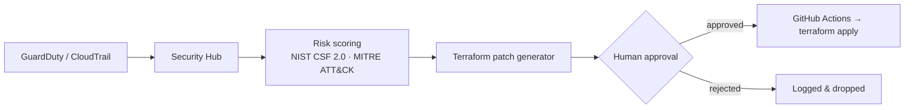
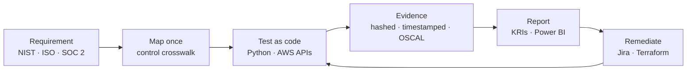

<p align="center">
  
</p>

<p align="center">
  
</p>

<p align="center">
  <a href="https://www.linkedin.com/in/mihirajmera1/"></a>
  <a href="mailto:ajmeramihir10@gmail.com"></a>
  <a href="https://postura.dev"></a>
  
</p>

---

### 👋 Hi, I'm Mihir Ajmera, GRC Engineer &amp; AI GRC practitioner

I'm a **GRC Engineer** at **Cisco** (previously a **GRC Analyst** at **KPMG**) working across **AI governance, AI compliance, cloud security compliance and IT risk**. I sit between the auditors and the engineers. Over **3+ years** in technology risk and compliance, the thread through all of it is the same: **controls should be tested by code, continuously, and produce evidence an auditor can re-perform**, not screenshots someone grabs once a quarter.

```yaml
role:        GRC Engineer @ Cisco            # Jun 2025 – present
previously:  GRC Analyst @ KPMG              # Jan 2022 – Jul 2024
focus:       [AI GRC, AI governance, AI risk & compliance, compliance-as-code, continuous controls monitoring, cloud security, TPRM]
frameworks:  [NIST CSF, NIST 800-53, NIST AI RMF, ISO 27001, SOC 2, PCI DSS, SOX/ITGC, CIS, COBIT]
education:   MS Cybersecurity, University of Maryland (May 2026)
location:    Maryland, USA
```

**Roles I'm a fit for:** GRC Engineer · GRC Analyst · AI GRC · AI Governance · AI Compliance · AI Risk · Security Compliance · Cloud Compliance · IT Risk &amp; Controls · Third-Party Risk (TPRM)

---

### 📈 Impact at a glance

<table>
  <tr>
    <td align="center" width="25%"><h2>~30%</h2><sub>less manual evidence collection via Python continuous-controls automation</sub></td>
    <td align="center" width="25%"><h2>40+</h2><sub>AWS / Azure cloud controls assessed and mapped to NIST CSF, CIS &amp; ISO 27001</sub></td>
    <td align="center" width="25%"><h2>25+</h2><sub>control gaps &amp; exceptions driven to closure through risk registers</sub></td>
    <td align="center" width="25%"><h2>20%</h2><sub>fewer overdue SOX/ITGC control actions across annual audit cycles</sub></td>
  </tr>
</table>

---

### 🤖 AI GRC: governance, risk &amp; compliance for AI systems

Most organizations are deploying AI faster than they can govern it. That's the part of GRC I find most interesting, and it's a core part of my current role:

- **AI risk &amp; impact assessments** for internal AI use cases under the **NIST AI Risk Management Framework (AI RMF)**, run in ServiceNow GRC.
- **Trustworthy-AI review**: each use case is assessed for **security, privacy, accountability, transparency and reliability** risk, with documented remediation.
- **AI risk tracking**: AI governance risks sit in the same risk register and Power BI reporting as security and compliance risk, so they get owners, treatment plans and deadlines.
- **Same engineering mindset**: AI controls should be mapped once, tested continuously and produce evidence an auditor can re-perform, just like cloud controls.

#### 🔐 Now building: [agent-access-review](https://github.com/MihirAjmera/agent-access-review) &nbsp;

**User access reviews for AI agents.** Companies recertify every human's access each quarter, but AI agents now hold GitHub tokens, database passwords, shell access and mailboxes, and almost nobody reviews them. This tool inventories what each agent and MCP server can read, write, execute and send, tests it against 12 controls, and produces the packet an auditor expects: a reviewer sign-off sheet, hashed evidence and OSCAL results.

- Flags **unowned and unapproved agents**, over-broad scopes, unsandboxed shell access, hardcoded secrets and dormant access, the same way an ITGC access review does for people.
- Detects **AI exfiltration paths**: one agent that reads sensitive data, ingests attacker-controlled content and can send data out is one prompt injection away from a breach (OWASP LLM01/LLM02).
- Mapped to **NIST 800-53, SOC 2, NIST AI RMF and the OWASP Top 10 for LLM Applications**.

---

### 🚀 Featured work

> Every project below is built the way I'd want it in production: mapped to real framework IDs, tested, and reproducible.

| Project | What it does | Why it matters | Stack |
|---|---|---|---|
| 🔐 [**agent-access-review**](https://github.com/MihirAjmera/agent-access-review) *(ongoing)* | Access reviews for AI agents and MCP servers: owner, approval, least privilege, secrets, dormancy and prompt-injection exfiltration paths, with a reviewer sign-off sheet and OSCAL output. | AI agents are the newest non-human identities, and nobody is running access reviews on them yet. | Python · OSCAL · OWASP LLM Top 10 · NIST AI RMF |
| ⭐ [**aws-compliance-as-code**](https://github.com/MihirAjmera/aws-compliance-as-code) | Read-only checks against an AWS account, each mapped **once** to NIST 800-53, SOC 2, ISO 27001 &amp; CIS. Writes SHA-256-hashed evidence and exports **OSCAL 1.1.2** assessment results. Fully tested against mocked AWS in CI. | Test once, satisfy four frameworks. Tamper-evident evidence an auditor can re-perform. | Python · boto3 · OSCAL · GitHub Actions |
| [**itgc-evidence-automation**](https://github.com/MihirAjmera/itgc-evidence-automation) | Pulls access mgmt, change mgmt &amp; config evidence, tests it against SOX ITGC objectives, and auto-generates an audit bundle + **Corrective Action Plan** register. | Automates the slowest part of the SOX audit cycle. | Python · AWS IAM · AWS Config · pytest |
| [**control-gap-analyzer**](https://github.com/MihirAjmera/control-gap-analyzer) | Joins control status against the **NIST CSF 2.0** catalog and risk-scores each gap (status × maturity × criticality) into a prioritized remediation backlog. | The gap analysis GRC teams do by hand in Archer/ServiceNow, made reproducible. | Python · pytest |
| [**grc-risk-dashboard**](https://github.com/MihirAjmera/grc-risk-dashboard) | Interactive risk register with KRI/KPI views, remediation aging, and exec-level risk reporting. | Turns a risk spreadsheet into something leadership actually reads. | SQL · SQLite · Streamlit |
| [**guardduty-siem-automation**](https://github.com/MihirAjmera/guardduty-siem-automation) | GuardDuty threat detection wired to automated incident response. | Detection → response without a human in the slow path. | Terraform · AWS GuardDuty |
| [**iam-zero-trust-security**](https://github.com/MihirAjmera/iam-zero-trust-security) | Zero Trust IAM design with automated compliance monitoring. | Least privilege enforced as code, not policy docs. | Terraform · AWS IAM |
| [**secure-vpc-architecture**](https://github.com/MihirAjmera/secure-vpc-architecture) | Segmented VPC built on Zero Trust networking principles. | Secure-by-default network baseline. | Terraform · AWS VPC |

#### 🛰️ Postura: autonomous cloud security remediation

My own platform: ingests Security Hub / GuardDuty findings, scores risk against **NIST CSF 2.0** and **MITRE ATT&amp;CK**, generates a Terraform patch, and ships it through CI/CD only after a human approves.



---

### 🧭 How I approach GRC



---

### 💼 Experience

<details open>
<summary><b>GRC Engineer · Cisco</b> · Jun 2025 – Present</summary>
<br/>

- **AI governance:** run AI risk &amp; impact assessments under **NIST AI RMF** in ServiceNow GRC, covering security, privacy, accountability, transparency and reliability.
- **Cloud controls:** assessed **40+** AWS/Azure controls (AWS Config, CloudTrail, Security Hub, IAM) against NIST CSF, CIS &amp; ISO 27001 and drove remediation.
- **Automation:** built Python evidence collection and control checks for continuous controls monitoring, cutting manual effort by **~30%**.
- **Policy-as-code:** embedded compliance checks into infrastructure changes with **Terraform + GitHub Actions**.
- **SOC 2 &amp; TPRM:** evidence, exceptions and remediation for SOC 2; vendor security assessments in **OneTrust**.
- **Risk reporting:** risk registers in Jira and Power BI dashboards, closing **25+** control gaps and exceptions.

</details>

<details>
<summary><b>GRC Analyst · KPMG</b> · Jan 2022 – Jul 2024</summary>
<br/>

- Technology risk assessments in **ServiceNow GRC** across **15+** business applications.
- Tested design &amp; operating effectiveness of **~50 controls per cycle** in **RSA Archer**.
- Control mapping to NIST CSF, NIST 800-53, COBIT &amp; PCI DSS; ISO 27001 policy reviews.
- **SOX/ITGC** audit readiness; reduced overdue control actions by **20%**.
- Identity &amp; vulnerability control reviews with **SailPoint** and **Qualys**.
- SQL-driven KRI/KPI reporting that cut manual reporting effort by **~15%**.

</details>

---

### 🛠️ Toolkit

| Domain | Tools &amp; Frameworks |
|---|---|
| **Frameworks** | NIST CSF · NIST 800-53 · NIST AI RMF · ISO 27001 · SOC 2 · PCI DSS · SOX/ITGC · CIS Controls · COBIT |
| **GRC Platforms** | ServiceNow GRC · RSA Archer · OneTrust · SailPoint · Qualys · Jira · Confluence |
| **Cloud Security** | AWS Config · CloudTrail · Security Hub · GuardDuty · IAM · Azure |
| **Automation** | Python · Terraform · GitHub Actions · Policy-as-Code · OSCAL |
| **Risk Analytics** | SQL · Power BI · Streamlit · KRI/KPI reporting |

<p align="left">
  
</p>

---

### 🎓 Education &amp; Certifications

**MS, Cyber Security**, University of Maryland, Baltimore · *Aug 2024 – May 2026*<br/>
**Bachelor's, Computer Engineering (Honors in Cybersecurity)**, University of Mumbai · *Aug 2020 – May 2024*

<p>
  
  
  
  
</p>

---

### 📫 Let's talk

Hiring for **GRC engineering, security compliance, cloud governance, or AI governance**? I'd like to hear about it. I'm also happy to talk about compliance-as-code, OSCAL, or making SOC 2 less painful.

<p align="center">
  <a href="https://www.linkedin.com/in/mihirajmera1/"></a>
  <a href="mailto:ajmeramihir10@gmail.com"></a>
</p>

<p align="center">
  
</p>
