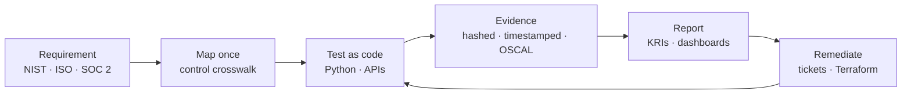

<p align="center">
  
</p>

<p align="center">
  
</p>

<p align="center">
  <a href="https://www.linkedin.com/in/mihirajmera1/"></a>
  <a href="mailto:ajmeramihir10@gmail.com"></a>
  <a href="https://www.posturanet.com"></a>
  
</p>

I'm a **GRC Engineer at Cisco** (previously **GRC Analyst at KPMG**) with 3+ years in technology risk and compliance, now focused on **AI governance, AI compliance and AI security**. I sit between auditors and engineers, and I build controls that are **tested by code, continuously, and produce evidence an auditor can re-perform**, not screenshots someone grabs once a quarter.

**Roles I'm a fit for:** GRC Engineer · GRC Analyst · AI GRC · AI Governance · AI Compliance · AI Risk · Security Compliance · Cloud Compliance · IT Risk &amp; Controls · Third-Party Risk (TPRM)

---

### 🚀 Flagship projects: open-source AI GRC tools

#### 🔐 [agent-access-review](https://github.com/MihirAjmera/agent-access-review): user access reviews for AI agents

[](https://github.com/Mihirajmera/agent-access-review/actions/workflows/tests.yml)
[](https://github.com/Mihirajmera/agent-access-review/releases)
[](https://scorecard.dev/viewer/?uri=github.com/Mihirajmera/agent-access-review)

Companies recertify every employee's access each quarter, but AI agents now hold GitHub tokens, database passwords, shell access and mailboxes, and almost nobody reviews them. This tool reads MCP configs (Claude Desktop, Cursor, VS Code) and agent manifests, tests each agent against **12 controls**, and produces the packet an auditor expects.

- Flags **unowned agents, stale approvals, over-broad scopes, plaintext secrets and dormant access**, exactly like an ITGC access review.
- Detects **AI exfiltration paths**: agents that read sensitive data, ingest attacker-controlled content and can send data out (OWASP LLM01/LLM02).
- Maps to **NIST 800-53, SOC 2, NIST AI RMF, OWASP LLM Top 10**; outputs a sign-off packet, hashed evidence and **OSCAL**.

```bash
pip install agent-access-review && agent-access-review demo
```
**→ [Read a sample review packet](https://github.com/Mihirajmera/agent-access-review/blob/main/sample-output/access-review.md)** (no install needed)

#### 🗡️ [llm-redteam-evidence](https://github.com/MihirAjmera/llm-redteam-evidence): LLM red-team results → audit evidence + release gate

[](https://github.com/Mihirajmera/llm-redteam-evidence/actions/workflows/tests.yml)
[](https://github.com/Mihirajmera/llm-redteam-evidence/releases)
[](https://scorecard.dev/viewer/?uri=github.com/Mihirajmera/llm-redteam-evidence)

Red-team tools like garak and promptfoo tell you a model *can* be jailbroken. A risk committee needs to know whether that's *acceptable*. This tool maps every attack to a control with a documented risk tolerance and turns tool output into evidence.

- **Risk tolerance per control** (e.g. 0% for system-prompt leakage, 5% for jailbreaks) with a **95% confidence bound**, because "0 failures in 20 attacks" still means the true rate could be 16%.
- **Model release gate**: blocks a new model version that's easier to attack than the approved one. Change management for AI.
- Maps to **OWASP LLM Top 10, MITRE ATLAS, NIST AI 600-1, NIST AI RMF, NIST 800-53**; outputs hashed evidence and **OSCAL**.

```bash
pip install llm-redteam-evidence && redteam-evidence demo
```
**→ [Read a sample assessment](https://github.com/Mihirajmera/llm-redteam-evidence/blob/main/sample-output/v2/report.md)** · **[See the v1 → v2 release gate](https://github.com/Mihirajmera/llm-redteam-evidence/blob/main/sample-output/comparison.md)**

---

### 📈 Impact at work

<table>
  <tr>
    <td align="center" width="25%"><h2>~30%</h2><sub>less manual evidence collection via Python continuous-controls automation</sub></td>
    <td align="center" width="25%"><h2>40+</h2><sub>AWS / Azure cloud controls assessed and mapped to NIST CSF, CIS &amp; ISO 27001</sub></td>
    <td align="center" width="25%"><h2>25+</h2><sub>control gaps &amp; exceptions driven to closure through risk registers</sub></td>
    <td align="center" width="25%"><h2>20%</h2><sub>fewer overdue SOX/ITGC control actions across annual audit cycles</sub></td>
  </tr>
</table>

---

### 🧰 More projects

| Project | What it does | Stack |
|---|---|---|
| ⭐ [**aws-compliance-as-code**](https://github.com/MihirAjmera/aws-compliance-as-code) | Read-only AWS checks, each mapped **once** to NIST 800-53, SOC 2, ISO 27001 &amp; CIS, with SHA-256-hashed evidence and **OSCAL** output. Tested against mocked AWS in CI. | Python · boto3 · OSCAL |
| [**itgc-evidence-automation**](https://github.com/MihirAjmera/itgc-evidence-automation) | Collects access, change and config evidence, tests it against SOX ITGC objectives, and generates an audit bundle plus a **Corrective Action Plan** register. | Python · AWS IAM · AWS Config |
| [**control-gap-analyzer**](https://github.com/MihirAjmera/control-gap-analyzer) | Risk-scores control gaps against the **NIST CSF 2.0** catalog into a prioritized remediation backlog. | Python · pytest |
| [**grc-risk-dashboard**](https://github.com/MihirAjmera/grc-risk-dashboard) | Interactive risk register with KRI/KPI views, remediation aging and exec reporting. | SQL · Streamlit |
| [**guardduty-siem-automation**](https://github.com/MihirAjmera/guardduty-siem-automation) | GuardDuty detection wired to automated quarantine, with a React findings dashboard ([live demo](https://mihirajmera.github.io/guardduty-siem-automation/), sample data). | Terraform · Lambda · React |
| [**iam-zero-trust-security**](https://github.com/MihirAjmera/iam-zero-trust-security) · [**secure-vpc-architecture**](https://github.com/MihirAjmera/secure-vpc-architecture) | Zero Trust IAM and network baselines as code, with automated compliance monitoring. | Terraform · AWS |

**🛰️ [PosturaNet](https://www.posturanet.com)**: my autonomous AWS security remediation platform. It ingests Security Hub and GuardDuty findings, scores risk against NIST CSF 2.0 and MITRE ATT&amp;CK, generates a Terraform fix, and applies it through CI/CD only after a human approves.

---

### 🧭 How I approach GRC



---

### 💼 Experience

<details open>
<summary><b>GRC Engineer · Cisco</b> · Jun 2025 – Present</summary>
<br/>

- **AI governance:** AI risk &amp; impact assessments under the **NIST AI RMF** in ServiceNow GRC, covering security, privacy, accountability, transparency and reliability, with AI risks tracked in the same register as security risk.
- **Cloud controls:** assessed **40+** AWS/Azure controls (AWS Config, CloudTrail, Security Hub, IAM) against NIST CSF, CIS &amp; ISO 27001 and drove remediation.
- **Automation &amp; policy-as-code:** Python evidence collection for continuous controls monitoring (**~30%** less manual effort); compliance checks embedded in **Terraform + GitHub Actions**.
- **SOC 2, TPRM &amp; reporting:** SOC 2 evidence and exceptions, vendor assessments in **OneTrust**, and risk registers in Jira and Power BI closing **25+** control gaps.

</details>

<details>
<summary><b>GRC Analyst · KPMG</b> · Jan 2022 – Jul 2024</summary>
<br/>

- Technology risk assessments in **ServiceNow GRC** across **15+** business applications.
- Tested design &amp; operating effectiveness of **~50 controls per cycle** in **RSA Archer**.
- Control mapping to NIST CSF, NIST 800-53, COBIT &amp; PCI DSS; ISO 27001 policy reviews.
- **SOX/ITGC** audit readiness; reduced overdue control actions by **20%**.
- Identity &amp; vulnerability control reviews with **SailPoint** and **Qualys**; SQL-driven KRI/KPI reporting (**~15%** less manual effort).

</details>

---

### 🛠️ Toolkit

| Domain | Tools &amp; Frameworks |
|---|---|
| **Frameworks** | NIST CSF · NIST 800-53 · NIST AI RMF · NIST AI 600-1 · ISO 27001 · SOC 2 · PCI DSS · SOX/ITGC · CIS · COBIT · OWASP LLM Top 10 · MITRE ATLAS |
| **GRC Platforms** | ServiceNow GRC · RSA Archer · OneTrust · SailPoint · Qualys · Jira · Confluence |
| **Cloud Security** | AWS Config · CloudTrail · Security Hub · GuardDuty · IAM · Azure |
| **Automation** | Python · Terraform · GitHub Actions · Policy-as-Code · OSCAL |
| **AI Security** | AI risk &amp; impact assessments · MCP / AI agent access review · LLM red-team evidence (garak &amp; promptfoo output) |
| **Risk Analytics** | SQL · Power BI · Streamlit · KRI/KPI reporting |

---

### 🎓 Education &amp; Certifications

**MS, Cybersecurity**, University of Maryland, Baltimore County (UMBC) · *Aug 2024 – May 2026*<br/>
**Bachelor's, Computer Engineering (Honors in Cybersecurity)**, University of Mumbai · *Aug 2020 – May 2024*

<p>
  
  
  
  
</p>

---

### 📫 Let's talk

Hiring for **GRC engineering, security compliance, cloud governance or AI governance**? I'd like to hear about it. Happy to talk compliance-as-code, OSCAL, AI agent security, or making SOC 2 less painful.

<p align="center">
  <a href="https://www.linkedin.com/in/mihirajmera1/"></a>
  <a href="mailto:ajmeramihir10@gmail.com"></a>
</p>

<p align="center">
  
</p>
